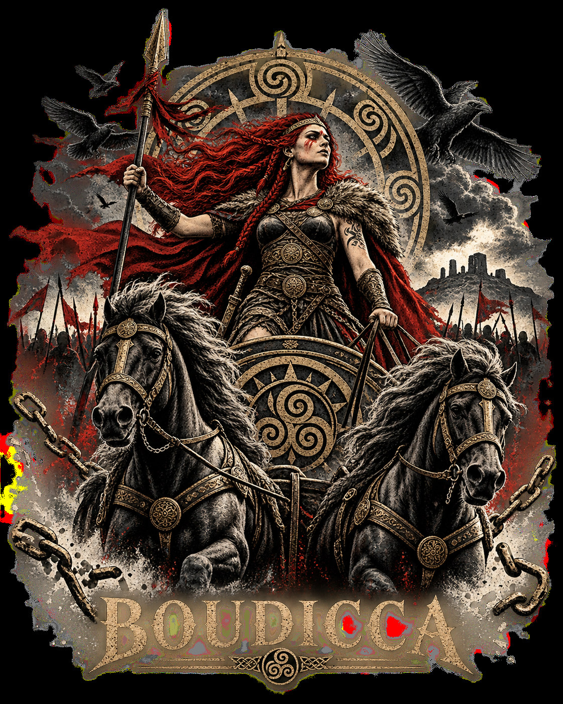
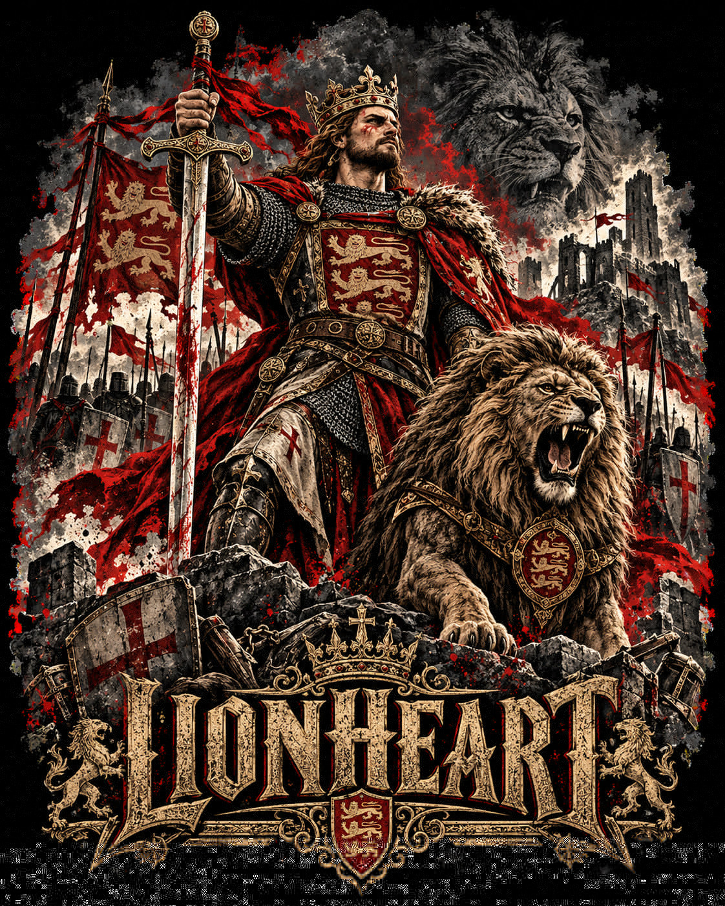
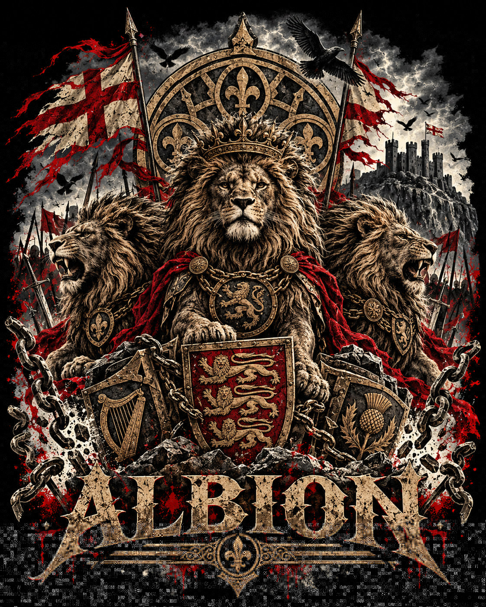
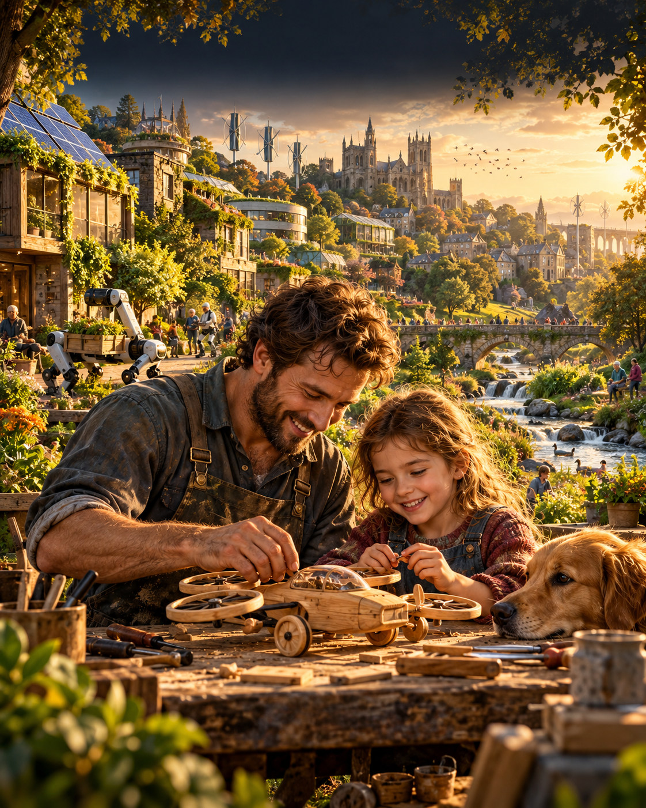

# Carried Worlds: Histories of Power and Possible Futures

Valerii Kushnir · 2026 · AI-assisted digital illustration · United Kingdom

Carried Worlds is a five-image collection moving from inherited images of power toward the responsibility of imagining a liveable future. Boudicca: Unbroken, Lionheart and Albion: Three Lions revisit courage, endurance and collective symbols through deliberately interpretive historical imagery. The Weight of Tomorrow places an older woman and a child beneath a fragile living world; The Future We Chose brings that responsibility into an everyday scene of making, family and technology. Across the sequence, the question shifts from who carries power to who carries the future. The works combine human creative direction and selection with OpenAI-generated core imagery. AI use is openly declared; these are digital illustrations, not documentary photographs or claims of historical reconstruction.

## Collection

### 1. Boudicca: Unbroken

[Open original JPEG](01_BOUDICCA_Unbroken_2026.jpg)

### 2. Lionheart

[Open original JPEG](02_LIONHEART_2026.jpg)

### 3. Albion: Three Lions

[Open original JPEG](03_ALBION_Three_Lions_2026.jpg)

### 4. The Weight of Tomorrow

[Open original JPEG](04_The_Weight_of_Tomorrow_2026.jpg)

### 5. The Future We Chose

[Open original JPEG](05_The_Future_We_Chose_2026.jpg)

## Artist

Valerii Kushnir is a Ukrainian digital artist based in Somerset, United Kingdom. His developing practice uses AI-assisted digital illustration to explore cultural memory, courage, care and possible futures. He directs concepts, visual selection and presentation, using generative tools to investigate how familiar symbols and imagined worlds can carry emotional meaning. He openly declares the use of AI and presents the works as creative interpretations.

## Relationship to It’s Alive…

The collection asks what makes a machine-generated image feel alive: not a claim that the machine is conscious, but the human meanings viewers bring to it. Historical symbols acquire presence through memory; an imagined living world becomes urgent through care; a future becomes credible through ordinary acts of making. The sequence moves from spectacular power to shared responsibility, connecting the festival's question about human-machine thresholds with the ethics of generating images that can move us.

## Technical notes

Five static RGB JPEG images, supplied in sequence. No sound, interactive component, equipment installation or artist travel is required for the proposed digital presentation. Suitable for a screen, projection or online gallery. Preserve the complete composition and aspect ratio; do not crop or stretch. The first, second, third and fifth images are 1122 × 1402 pixels; the fourth is 2121 × 3000 pixels. These are the supplied native pixel sizes; no claim of larger print resolution is made. At 300 dpi these correspond to approximately 95 × 119 mm and 180 × 254 mm respectively. Contact the artist before agreeing any physical production or cost.

## AI disclosure

Core imagery was generated using OpenAI tools under human creative direction, followed by human selection and preparation. No documentary authenticity is claimed. No human photographic model or performer is represented as having participated in these fictional scenes.

© 2026 Valerii Kushnir. Provided for portfolio viewing and curatorial review. Inclusion here does not grant a general licence for commercial reuse.
