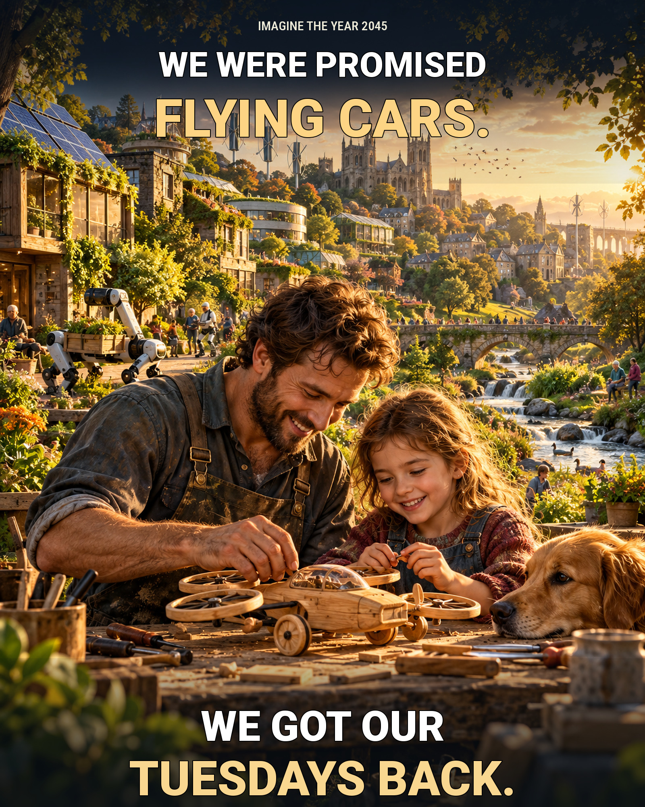

# We Got Our Tuesdays Back

**Original AI-assisted image by Valerii Kushnir (United Kingdom), 2026.**

> We were promised flying cars. We got our Tuesdays back.

Imagine the year 2045. Clean energy powers our towns, useful machines handle repetitive work, and parents have more time to build things with their children.

The future worth building is not only one with greater technical power. It is one that gives people more ordinary, precious hours with those they love.

**Creation disclosure:** Concept development and artistic direction by Valerii Kushnir, using OpenAI generative image tools and digital editing to prepare the completed artwork.

Submitted as an original entry for the **2026 Existential Hope Meme Prize**.

[Full-resolution artwork](We_Got_Our_Tuesdays_Back.jpg)
