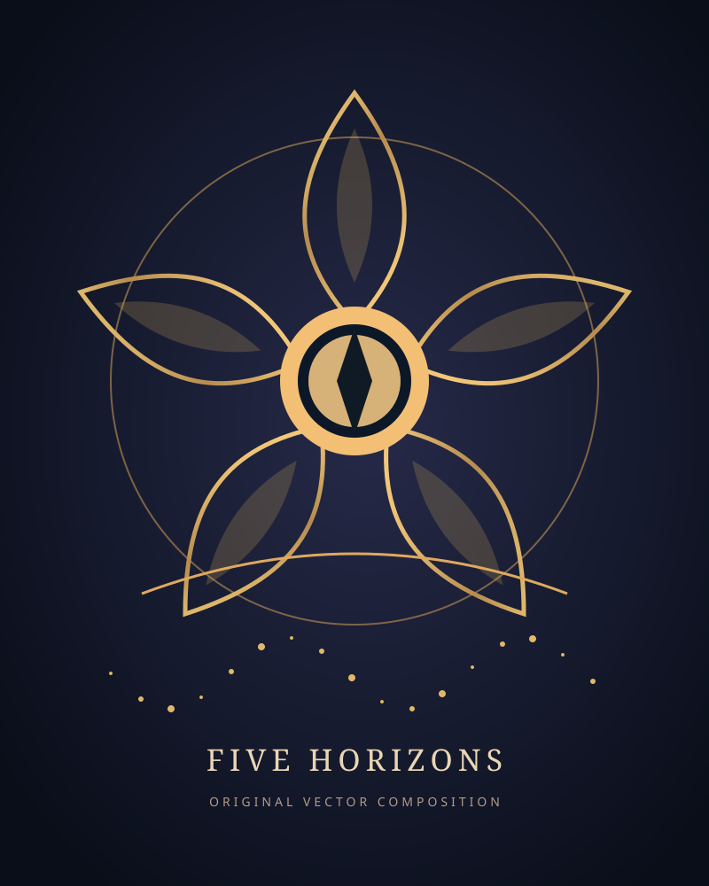
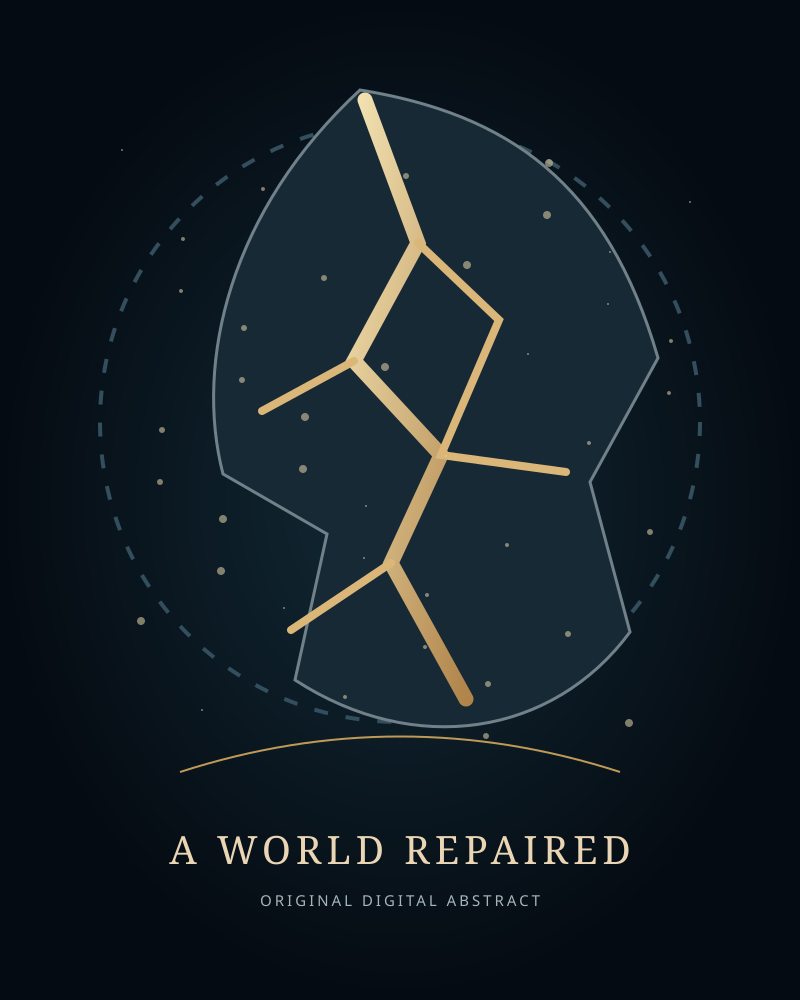

# Valerii Kushnir — Digital Art Portfolio

Independent digital art and AI-assisted visual storytelling. Based in the United Kingdom.

## Selected visual studies (October 2026)

### Five Horizons

Original geometric vector illustration exploring five different journeys converging toward a shared horizon.

### A World Repaired

Original vector composition exploring a fractured future repaired with threads of light.

## Practice
Concept development, vector illustration, AI-assisted illustration, image editing, and original storytelling. All artwork presented here is original and created for this portfolio.

Contact: valerakusnir630@gmail.com
