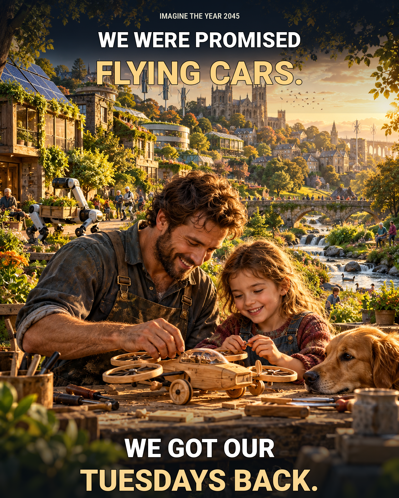

# We Got Our Tuesdays Back

**Existential Hope Meme Prize 2026 | Artist: Valerii Kushnir | United Kingdom**

> Imagine the year 2045. We were promised flying cars. We got our Tuesdays back.

What if the greatest technological breakthrough were **time with the people we love**? A hopeful, achievable future with clean energy, helpful automation and flourishing communities would not just make things faster. It would give families more time to make, learn, rest and care for each other.

**Concept:** A parent and child build a toy aircraft together, while solar power, green infrastructure and friendly machines help their wider community thrive.

**Format:** Original AI-assisted digital poster, 1600 × 2000 PNG. Creative concept, composition direction and post-production by Valerii Kushnir with generative AI tools.

This work is publicly posted for the [Existential Hope Meme Prize 2026](https://www.existentialhope.com/existential-hope-meme-prize). #xhopememeprize

[Open the full-resolution artwork](./We_Got_Our_Tuesdays_Back.png)
